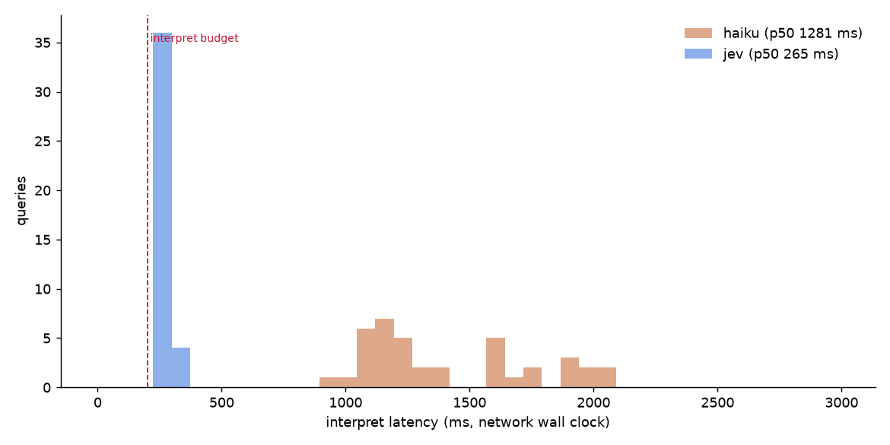

# Speed report — 2026-10-14 14:10 UTC

## Summary

How long shoppers wait. *Typical* is what most searches feel like; *slow* is the slowest 1 in 20.

| | Suggestions appear in (typical) | Results appear in (typical) | Results appear in (slow) | Feels instant?* |
|---|---|---|---|---|
| **Today's site search** | under 0.1 s | under 0.1 s | under 0.1 s | ✅ yes |
| **Claude Haiku** | 1.36 s | 1.30 s | 2.09 s | ❌ no |
| **TypeSafe Jev** | 0.29 s | 0.28 s | 0.35 s | ❌ no |
| **Rules only (no AI)** | — | under 0.1 s | under 0.1 s | ✅ yes |

\* under 0.3 s even for slow searches.

- TypeSafe Jev shows results **4.6× faster** than Claude Haiku.
- About **0.22 s** of every AI call is just the internet round trip from this machine to the AI provider. Hosting the search service near the providers would cut that.
- 80% of test searches are simple enough to answer without AI (instant and free).

---

# Technical appendix

Machine: Mikes-MacBook-Pro.local · macOS-26.6.2-arm64-arm-64bit-Mach-O · Python 3.14.5. Latency to the APIs depends on where this runs; compare with the network baseline below.

Queries: 40 from eval/goldens.jsonl · cache disabled · in-process timing (`time.perf_counter`), so numbers exclude browser↔server HTTP.

## Verdict vs latency budget

Budget: end-to-end p95 ≤ 300 ms, interpret p95 ≤ 200 ms. Fast-path-eligible queries (no model call needed): **80%**.

| Engine | Interpret p95 | Total p95 | Verdict |
|---|---|---|---|
| baseline | — ms | 21 ms | ✅ pass |
| haiku | 2075 ms | 2095 ms | ❌ over budget |
| jev | 327 ms | 346 ms | ❌ over budget |
| rules | — ms | 9.5 ms | ✅ pass |

## Network baseline (no model work)

Bare HTTPS GET to the API host. Subtract *warm* from interpret latency to estimate model + queueing time.

| Host | Cold p50 (new TLS) | Warm p50 | Warm p95 |
|---|---|---|---|
| https://api.anthropic.com/ | 246 ms | 218 ms | 222 ms |
| https://api.typesafe.ai/ | 315 ms | 220 ms | 244 ms |

## Cold vs warm client

| Engine | First call (cold) | Warm p50 | Warm p95 |
|---|---|---|---|
| haiku | 1616 ms | 1410 ms | 1793 ms |
| jev | 404 ms | 260 ms | 319 ms |

## Sequential latency by stage (ms)

### baseline — 40 ok, 0 errors

| Stage | p50 | p90 | p95 | p99 | min | max |
|---|---|---|---|---|---|---|
| normalize | 0.6 | 0.8 | 0.9 | 1.4 | 0.6 | 1.8 |
| retrieve | 8.4 | 17 | 20 | 54 | 2.3 | 58 |
| total | 9.1 | 18 | 21 | 55 | 2.9 | 59 |

### haiku — 40 ok, 0 errors

| Stage | p50 | p90 | p95 | p99 | min | max |
|---|---|---|---|---|---|---|
| normalize | 1.5 | 1.8 | 1.8 | 2.1 | 0.5 | 2.2 |
| interpret_network | 1281 | 1966 | 2075 | 2986 | 900 | 3568 |
| retrieve | 17 | 24 | 27 | 30 | 9.6 | 30 |
| total | 1301 | 1992 | 2095 | 3008 | 916 | 3591 |

Estimated model-side time (interpret p50 − warm network p50): **1063 ms**

Mean cost/query $0.0001153 · mean input tokens 4445 (cached 4108)

### jev — 40 ok, 0 errors

| Stage | p50 | p90 | p95 | p99 | min | max |
|---|---|---|---|---|---|---|
| normalize | 1.5 | 1.7 | 1.8 | 1.9 | 0.7 | 2.0 |
| interpret_network | 265 | 298 | 327 | 347 | 241 | 351 |
| retrieve | 16 | 21 | 29 | 41 | 7.0 | 48 |
| total | 284 | 313 | 346 | 382 | 260 | 401 |

Estimated model-side time (interpret p50 − warm network p50): **45 ms**

Mean cost/query $0.0000368 · mean input tokens 876

### rules — 40 ok, 0 errors

| Stage | p50 | p90 | p95 | p99 | min | max |
|---|---|---|---|---|---|---|
| normalize | 0.6 | 1.0 | 1.1 | 1.4 | 0.5 | 1.5 |
| retrieve | 4.3 | 6.8 | 8.3 | 14 | 1.9 | 17 |
| total | 5.0 | 7.6 | 9.5 | 15 | 2.8 | 18 |

## Type-ahead (one lookup per word typed)

| Engine | Lookups | p50 | p95 | max |
|---|---|---|---|---|
| baseline | 139 | 4.7 ms | 16 ms | 62 ms |
| haiku | 139 | 1364 ms | 2286 ms | 11506 ms |
| jev | 139 | 289 ms | 484 ms | 594 ms |

## Payload sensitivity

| Variant | n | Interpret p50 | Interpret p95 | Mean input tokens |
|---|---|---|---|---|
| haiku: prompt caching on | 40 | 1281 ms | 2075 ms | 4445 |
| haiku: prompt caching off | 40 | 1218 ms | 1759 ms | 4445 |
| jev: 5 questions (default) | 40 | 265 ms | 327 ms | 876 |
| jev: 3 questions | 40 | 256 ms | 294 ms | 720 |

## Interpret latency distribution

